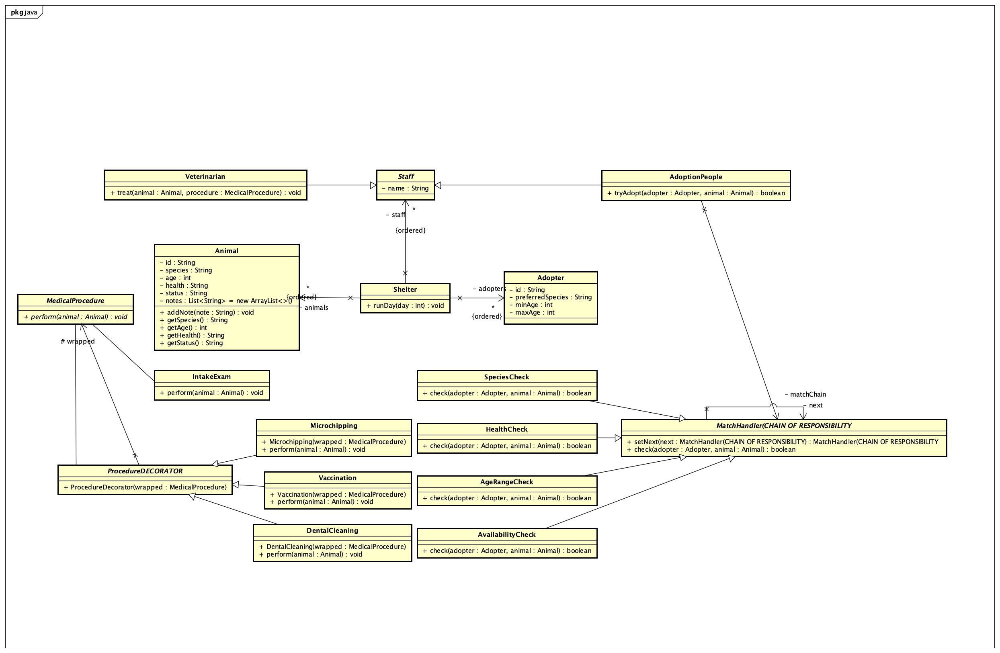

# SER316-Fall26-PetShelter
This is an X-day (≥7-day) simulation for a pet shelter.

**Mandatory simulation behavior**
These requirements do not count toward the six selected subrequirements:
1. Run automatically for at least seven cycles, where a cycle may represent one day.
2. Accept –days and –seed command-line arguments. The same day count and seed
   must produce the same simulation result.
3. Produce consistent CYCLE, EVENT, and SUMMARY output (println) showing time progression, important state changes, and final state.
4. Include more than static sample data: objects must be created or updated and
   interact as the simulation progresses.

** Grouping choices **
R1. Animals and intake
    - R1.1  Start with at least five animals and track an ID, species, age, and health status	
    - R1.2 Allow new animals to arrive during the simulation through at least one intake source
such as stray, surrender, or transfer.

R2. People and assignments
    - R2.1 Define at least two staff roles with different responsibilities
R3. Adoption and matching
    - R3.1 Represent adopter preferences using at least two characteristics such as species, size,
age range, or temperament.
    - R3.2  Match an adopter to an eligible animal and update the relevant adoption state.
R4. Care and medical events
    - R4.2 Schedule and perform a medical action such as an intake exam, treatment, or vaccination.

**Design Pattern Choice (≥2 design patterns)**

1. **Chain of Responsibility**
    **Design Problem:** Deciding on whether an animal matches a potential adopter. Assuming from the prompt, there are different
attributes people look for in a new fur-friend. Creating a giant if/else or switch statement would be easy to keep adding but hard to maintain.
    **Solution:** Each rule becomes its own handler. A match request goes through a chain until it reaches the end or a handler rejects it.
2. **Decorator**
   **Design Problem:** New arrivals need different medical procedures(Vaccinations, MicroChips, DentalCleaning). A subclass for every procedure would quickly jump up complexity.
   **Proposed Solutio:** One base procedure wrapped at runtime with decorators with each decorator detailing one procedure.

**The Vision!**
1. Intake: A new animal arrives (R1.2)
2. Veterinarian comes into  play (R4.2,R2.1) (Decorator)
3. Adoption Agency (R2.1) runs the adopter and animal through the match chain (Chain of Responsibility)
4. Print out the adoption event + summary noting of the changes and things that happen in a day.

Below decorator pattern is on the bottom left and the CoR pattern is the bottom right.

